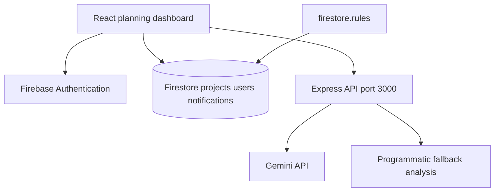

<a id="top"></a>

<div align="center">

# ⏳ DeadlineAI

**A Firebase-backed planning dashboard with Gemini-assisted workload and risk analysis.**


[Repository](https://github.com/ashishgiije/deadlineAi) · [Overview](#overview) · [Architecture](#architecture) · [Setup](#setup) · [Validation](#testing-and-validation) · [Audit](AUDIT_REPORT.md)

</div>

## Overview

DeadlineAI helps users organize projects and inspect estimated workload, deadline risk, and recovery plans. The browser uses Firebase directly for user data, while an Express server runs Gemini requests and programmatic fallback logic. Generated advice is heuristic assistance, not a measured prediction model.

## Visual preview

**Screenshot placeholder:** No verified application screenshot is supplied here. Capture the planning dashboard and a clearly identified AI/fallback analysis. No image is fabricated.

## Key features

- Firebase sign-in and profile management.
- Project creation, subtasks, progress, and dashboard views.
- AI task analysis, plan generation, risk prediction, rescue mode, and chat.
- Consolidated analysis with fallback behavior for provider failures.
- Analytics, notifications, settings, and deadline-focused views.

## Technology stack

| Technology | Role in this checkout |
|---|---|
| React 19 + TypeScript + Vite | Planning interface |
| Express + Google GenAI SDK | AI endpoints and fallback responses |
| Firebase Auth + Firestore | Browser authentication and persisted projects/profiles/notifications |
| Tailwind CSS + Motion | Visual interface and animation |
| Recharts | Analytics charts |

## Architecture



## Application workflow

Sign in → create a project and deadline → track subtasks/progress → request workload/risk analysis → inspect rescue suggestions → persist project updates to Firestore. Responses may be generated by fallback code when Gemini fails.

## Setup

```bash
git clone https://github.com/ashishgiije/deadlineAi.git
cd deadlineAi
```

Use Node.js 22+ and npm.

```bash
npm ci
cp .env.example .env
```

Configure `GEMINI_API_KEY` privately. The Firebase browser configuration is embedded in `src/lib/firebase.ts`; a usable project, enabled sign-in providers, authorized local domain, and deployed Firestore rules are needed for signed-in workflows. Firebase web configuration identifies a project and is not itself an admin credential.

```bash
npm run dev
```

Open `http://localhost:3000`. Run one port-3000 application at a time.

```bash
npm run lint
npm run build
NODE_ENV=production npm start
```

The production build bundles the server and client; Firebase hosting configuration alone does not host the Express AI service. Secure the server API and provision provider/network access before public deployment.

## Project structure

```text
server.ts                 # Gemini endpoints, retries, fallback logic
src/App.tsx               # Auth and application state
src/components/           # Dashboard, projects, rescue, chat, analytics
src/lib/firebase.ts       # Firebase browser project configuration
src/lib/rescueHelper.ts   # Rescue calculations
firestore.rules           # Firestore ownership policies
firebase.json             # Firebase deployment configuration
```

## AI integration

The server requests `gemini-3.5-flash` with `gemini-3.1-flash-lite` as a fallback in the inspected source. Those names describe configured identifiers, not verified provider availability. No custom model training, dataset, calibrated risk evaluation, or accuracy result is included. Programmatic fallbacks can return useful-looking data even when no model request succeeded; inspect fallback flags and server logs.

## API

All listed endpoints are POST routes in `server.ts`. They currently have no server-side Firebase token verification.

| Path | Purpose |
|---|---|
| `/api/analyze-task` | Task workload/deadline analysis |
| `/api/generate-plan` | Plan generation |
| `/api/predict-risk` | Risk analysis |
| `/api/rescue-mode` | Recovery suggestions |
| `/api/additional-ai` | Additional assistance |
| `/api/consolidated-analysis` | Combined analysis |
| `/api/chat` | Assistant response |

```bash
curl -X POST http://localhost:3000/api/analyze-task \
  -H 'Content-Type: application/json' \
  -d '{}'
```

This validation example returns HTTP 400 with `{"error":"Missing task or deadline"}`. A real analysis requires `task` and `deadline`, optionally `progress`, and working provider access.

## Data access

The browser reads/writes `users`, `projects`, and `notifications`. Firestore rules restrict access to authenticated owner IDs. That protection does not automatically authenticate requests to the separate Express server.

## Testing and validation

Current source review and checks (4 November 2026):

`npm ci`, `npm run build`, and `npm run lint` passed. Signed-in Firebase and successful Gemini inference were not verified; no provider credential is configured. HTTP GET / returned 200 and expected page content; POST /api/analyze-task with empty input returned expected 400 JSON

Use the setup commands above and the documented workflow for a local smoke check. No passing automated application suite is claimed where none exists.

## Limitations and roadmap

- AI provider calls and signed-in Firebase workflows need external configuration and were not fully verified here.
- Server routes do not authenticate Firebase users or enforce per-user quotas.
- Fallback outputs must not be presented as validated predictive accuracy.
- Suggested roadmap: server token verification, rate limits, rule tests, provider contract tests, and chart code splitting.

<details>
<summary>Troubleshooting and contributions</summary>

Check the runtime versions and working directory first. For dependency installation failures, preserve TLS and checksum verification and inspect the first error. For external services, verify your local configuration and account permissions without sharing secret values.

Before contributing, read [the audit](AUDIT_REPORT.md), reproduce the affected behavior, and keep documentation changes separate from application fixes. Add tests for changed behavior and describe remaining limitations accurately.

</details>

## Author

**Ashish Gije** · [GitHub](https://github.com/ashishgiije)

[Back to top](#top)
